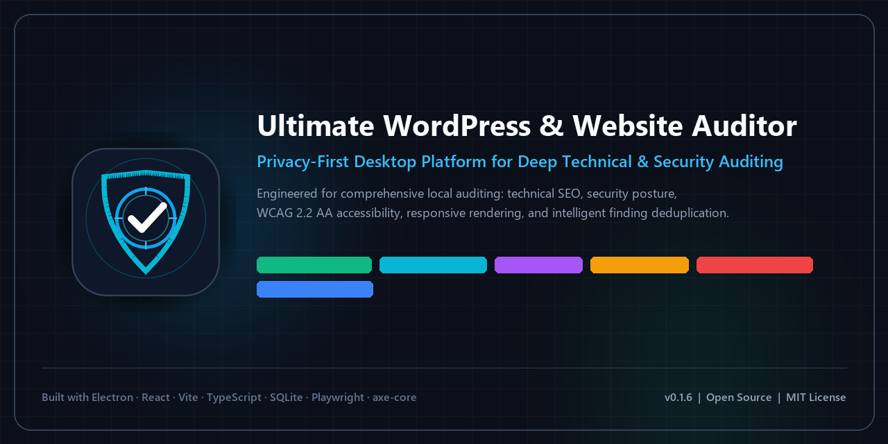

# Ultimate WordPress & Website Auditor

<p align="center">
  
</p>

<p align="center">
  <a href="https://github.com/Ahmedhamdy009/ultimate-wordpress-auditor/actions/workflows/ci.yml"></a>
  <a href="https://github.com/Ahmedhamdy009/ultimate-wordpress-auditor/releases/tag/v0.1.7"></a>
  <a href="LICENSE"></a>
  
  
  <a href="https://www.electronjs.org/"></a>
  <a href="https://react.dev/"></a>
  <a href="https://www.typescriptlang.org/"></a>
</p>

---

**Ultimate WordPress & Website Auditor** is an open-source, local-first Windows desktop application engineered for developers, QA engineers, and website owners. It performs structured technical SEO, security posture, accessibility, and responsive layout audits of WordPress installations and public websites.

> [!IMPORTANT]
> **Project Status: Active Developer Preview (v0.1.7 Alpha)**  
> This software is under active engineering and real-world field validation. It is an alpha release intended for testing, review, and developer preview, not a finished commercial product.

---

## Download & Installation (Windows x64)

The latest pre-packaged Windows installer is available directly from GitHub Releases:

📦 **[Download Ultimate WordPress & Website Auditor Setup 0.1.7 (x64 Installer)](https://github.com/Ahmedhamdy009/ultimate-wordpress-auditor/releases/download/v0.1.7/Ultimate.WordPress.Website.Auditor.Setup.0.1.7.exe)**  
*(Release tag: [`v0.1.7`](https://github.com/Ahmedhamdy009/ultimate-wordpress-auditor/releases/tag/v0.1.7))*

### Package Integrity & Checksum
- **Installer Asset:** `Ultimate.WordPress.Website.Auditor.Setup.0.1.7.exe`
- **File Size:** `125,812,103 bytes (~120 MB)`
- **SHA-256 Checksum:**  
  `c82e7d94e764dd8cddb778c3459aa9a01675ecdaf74a69f69c6c1ef24f3cf9cf`

You can verify the downloaded installer integrity in PowerShell:
```powershell
Get-FileHash -Path ".\Ultimate.WordPress.Website.Auditor.Setup.0.1.7.exe" -Algorithm SHA256
```

### Note on Windows SmartScreen
Because this is an open-source alpha developer build without an expensive commercial EV (Extended Validation) code signing certificate, Windows Defender SmartScreen may display a warning dialog stating *"Windows protected your PC / Unknown Publisher"*.  
To proceed with testing:
1. Click **More info**.
2. Click **Run anyway**.

---

## Architecture & Privacy Model

The application operates on a **Local-First, Privacy-Conscious Architecture**:

- **Internet Usage Scope:** The application requires outbound internet access solely to connect to and fetch resources from the user-specified target website.
- **Local Execution & Storage:** All HTML parsing, DOM analysis, browser execution, layout computation, finding deduplication, and report generation take place **100% locally on your machine**.
- **Zero Cloud Telemetry:** Scanned URLs, page contents, DOM trees, screenshots, and audit findings are never transmitted to external cloud services, third-party APIs, or telemetry providers. Everything is stored locally in SQLite (`better-sqlite3`).

---

## Auditing & Workflow Capabilities (v0.1.7)

### 1. Technical SEO & Content Quality
- **Canonical URL Integrity:** Identifies self-referencing loops, cross-domain canonical mismatches, missing canonical links, and canonical-to-redirect regressions.
- **Metadata Analysis:** Validates title tags, meta descriptions, viewport tags, OpenGraph attributes, and robots directives.
- **Content Structure Heuristics:** Detects empty or thin pages while intelligently differentiating WordPress taxonomy archives (category, tag, and custom taxonomy pages) from single content articles to prevent false alarms.
- **Robots & Sitemap Verification:** Checks `robots.txt` access policies and XML sitemap discoverability.

### 2. Security Posture Checks
- **HTTP Security Headers:** Audits response headers for `Content-Security-Policy` (CSP), `Strict-Transport-Security` (HSTS), `X-Frame-Options`, `X-Content-Type-Options`, and `Referrer-Policy`.
- **Information Leakage:** Detects server version exposure tokens (e.g., Apache, Nginx, PHP signatures) and WordPress generator meta tags.
- **External Link Hardening:** Flags external links opening in new tabs without `rel="noopener"` or `rel="noreferrer"`.
- **SSRF Protection:** Built-in isomorphic `ScopeGuard` blocks scans targeting private IPv4/IPv6 networks (RFC 1918, link-local, loopback) and validates domains against the official IANA TLD registry.

### 3. Automated Accessibility Evaluation (axe-core)
- **Engine:** Bundled offline `axe-core@4.14.0` running in a headless Playwright Chromium browser.
- **Rule Coverage:** Checks a subset of automatable WCAG 2.0 A/AA, WCAG 2.1 A/AA, and WCAG 2.2 AA rules (contrast, ARIA roles, form labels, alt text, heading hierarchy).
- **Manual Review Segregation:** Differentiates confirmed violations from items requiring human judgment (such as ambiguous contrast against dynamic CSS gradients), tagging them as `[A11Y Needs Review]` with `needs_manual_review` status.

### 4. Layout Stability & Responsive Inspection
- **Cumulative Layout Shift (CLS):** Captures layout shifts during initial rendering in mobile and desktop viewports.
- **Text-Clipping & Overflow:** Detects CSS text truncation and unwanted page-level horizontal overflow.
- **Responsive Viewports:** Emulates mobile, tablet, and desktop viewport dimensions.
- **Atomic Visual Evidence:** Captures localized PNG element and viewport screenshots stored safely on the local disk.

### 5. Consolidated Reporting & Workflow Modernization
- **Interactive Overview Dashboard:** Aggregates real-time health scores, issue severity distributions, recent scans, and site metrics with direct workflow navigation.
- **Dedicated Reports Workflow:** Filter, sort, and inspect generated audit reports with instant regeneration from historical scans.
- **Multi-Format Exports:** Generates self-contained interactive HTML reports, structured JSON exports, and tabular CSV spreadsheets.
- **Sandboxed Previews & Security Hardening:** In-app report previews enforce strict HTML iframe sandboxing (`sandbox=""`) and authoritative Content Security Policy (`default-src 'none'; script-src 'none'; style-src 'unsafe-inline'; img-src data:; connect-src 'none'; frame-src 'none'; object-src 'none'`), neutralizing script execution, network egress, and breakout navigation while safely displaying embedded base64 screenshots.
- **RFC 4180 CSV Engine:** Robust deterministic state-machine parser handles embedded newlines, escaped quotes, and commas without schema distortion.
- **Template Deduplication:** Groups repeated findings sharing identical rules and normalized CSS selectors across multiple crawled pages to eliminate audit fatigue, while preserving raw individual evidence, occurrence counts, and full URL lists.

---

## Important Scope Distinctions & Limitations

To ensure realistic expectations, please review the following boundaries:

- **External Black-Box vs. Internal Telemetry:** Version 0.1.7 operates strictly as an **external auditor** (analyzing HTTP responses, DOM structures, and rendered browser sessions). It does **not** inspect internal WordPress database queries, server PHP configurations (`wp-config.php`), or private server logs. A companion WordPress plugin for internal telemetry is scheduled for Phase 6 of the project roadmap.
- **No Automated Fixes:** The application identifies, categorizes, and documents issues with visual evidence and technical explanations; it does **not** modify, patch, or automatically write code to the scanned website.
- **Not a Complete WCAG Audit:** Automated accessibility engines detect approximately 30% to 57% of WCAG issues. A passing automated audit does **not** guarantee complete legal WCAG compliance; manual assistive technology testing remains essential.
- **Not a Penetration Test:** Security audits evaluate surface HTTP headers and public information disclosures. The application does **not** perform active exploit payloads, SQL injection tests, fuzzing, brute-forcing, or denial-of-service testing.
- **Not Full Lab Lighthouse:** Current performance metrics focus on layout shifts (CLS), responsive text-clipping, and page load timings. Full lab Lighthouse / Core Web Vitals scoring is planned for future phases.

---

## Security Model

The desktop application enforces the **Principle of Least Privilege**:

```
+-------------------------------------------------------------+
|                     Electron Main Process                   |
|  - Node.js 24 + TypeScript (Hardened Dispatcher)            |
|  - Exclusive SQLite Ownership (better-sqlite3 WAL Mode)     |
|  - Outbound ScopeGuard (IANA & SSRF Private IP Blocking)   |
|  - Headless Playwright Chromium & axe-core Evaluator        |
+-------------------------------------------------------------+
                              |
               Typed IPC Bridge (@auditor/shared)
               Zod Schema Validation & Sender Verification
                              |
+-------------------------------------------------------------+
|                     Preload Bridge Context                  |
|  - contextIsolation = true, sandbox = true                 |
|  - Minimal, strictly typed window.electronAPI               |
+-------------------------------------------------------------+
                              |
+-------------------------------------------------------------+
|                     React 19 Renderer UI                    |
|  - nodeIntegration = false                                  |
|  - Zero direct access to Node.js APIs or Filesystem         |
|  - Strict Content Security Policy (Vite CSP)                |
+-------------------------------------------------------------+
```

---

## Developer Guide & Building from Source

### System Requirements
- **OS:** Windows 10 / Windows 11 (x64)
- **Node.js:** `>= 22.0.0` (Recommended: Node 24.x)
- **Package Manager:** `pnpm >= 9.0.0` (Lockfile: `9.15.4`)
- **C++ Tools (Optional):** Precompiled dual-ABI native SQLite binaries are included in the repository for Windows x64. Visual Studio 2022 C++ Build Tools are only required if recompiling native addons.

### Installation & Quality Gate Commands

```powershell
# 1. Clone repository
git clone https://github.com/Ahmedhamdy009/ultimate-wordpress-auditor.git
cd ultimate-wordpress-auditor

# 2. Configure project environment (sets local pnpm and node paths)
. .\scripts\env.project.ps1

# 3. Install dependencies
pnpm install --frozen-lockfile

# 4. Verify package exports and run quality gates
pnpm test:package-exports
pnpm format:check
pnpm lint
pnpm typecheck

# 5. Run the complete automated test suite (1,360 tests across 131 files)
pnpm test

# 6. Launch the desktop application in development mode
pnpm --filter @auditor/desktop dev

# 7. Build the production Windows NSIS installer
pnpm dist
```

Upon successful build, the installer is produced at:  
`apps/desktop/dist/Ultimate WordPress & Website Auditor Setup 0.1.7.exe`

---

## Quality & Verification Metrics

Every release candidate is verified against six strict automated quality gates:

- **133 Test Files / 1,391 Automated Tests** (100% passing via Vitest)
- **Zero ESLint Errors & Warnings** (TypeScript ESLint strict mode)
- **Zero TypeScript Compiler Errors** (`tsc --noEmit` across all workspaces)
- **Deterministic Package Exports** (verified against ESM module resolution)
- **Native Dual-ABI Support** (Node.js ABI 137 for tests, Electron ABI 149 for desktop runtime)
- **Single-Instance Enforcement** (Electron `requestSingleInstanceLock` protecting SQLite state)

---

## Development Roadmap

- [x] **Phase 0–1:** Project foundation, hardened Electron shell, typed IPC, React 19 UI.
- [x] **Phase 2:** SQLite persistence layer, migrations, project/site management.
- [x] **Phase 3:** Safe external crawler, SSRF scope guard, technical SEO and security header rules.
- [x] **Phase 4:** Headless Playwright browser, axe-core 4.14.0 a11y, CLS, viewport screenshots.
- [x] **Phase 5:** Unified ScanOrchestrator, standalone HTML and JSON reporting engines.
- [x] **Batch 6.1 (v0.1.6):** Truthful coverage accounting, taxonomy archive classification, intelligent finding consolidation.
- [x] **Phase 7 — Batch 7.1 & 7.1.1 (v0.1.7):** UI/UX modernization (Overview dashboard metrics, Reports & Exports workflow, CSV export, CSP-hardened secure HTML preview, RFC 4180 parsing).
- [ ] **Phase 6:** Companion WordPress Plugin (read-only PHP telemetry for internal database health and configuration audits).
- [ ] **Phase 7.2:** Comprehensive Technical SEO & Performance engine.
- [ ] **Phase 8:** Vulnerability Intelligence (offline CVE / vulnerability database integration).
- [ ] **Phase 9:** Elementor & WooCommerce deep structural diagnostics.
- [ ] **Phase 10:** Automated diagnostic comparison and retest engine.

---

## License

This project is open-source software licensed under the [MIT License](LICENSE).

---

## Author & Maintainer

**Ahmed Hamdy**  
- GitHub: [@Ahmedhamdy009](https://github.com/Ahmedhamdy009)  
- Email: `ahmedhamdybayoumi2006@gmail.com`  
- Repository: [ultimate-wordpress-auditor](https://github.com/Ahmedhamdy009/ultimate-wordpress-auditor)
