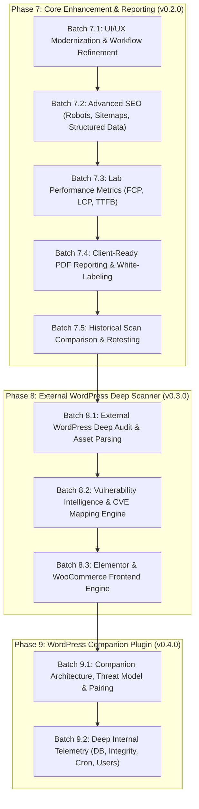

# Product & Engineering Gap Analysis — Comprehensive Forensic Review & Development Roadmap
**Application:** Ultimate WordPress & Website Auditor  
**Local Workspace:** `D:\ahmed`  
**GitHub Repository:** [https://github.com/Ahmedhamdy009/ultimate-wordpress-auditor](https://github.com/Ahmedhamdy009/ultimate-wordpress-auditor)  
**Main Branch Commit Baseline:** `ba6dbe4` (synchronized with `origin/main`)  
**Current Published Release:** `v0.1.6 — Developer Preview` (Tag: `v0.1.6`)  
**Automated Test Baseline:** 1,360 tests across 131 test files (100% passing)  
**Audit Date:** November 12, 2026  
**Document Status:** Approved Analysis & Roadmap Specification (Analysis-Only — No Code Modifications)  

---

## 1. Executive Summary

This forensic gap analysis provides an evidence-based assessment of the **Ultimate WordPress & Website Auditor** at version **v0.1.6**. The application has established a robust, privacy-first, local desktop architecture combining Electron, React, TypeScript, SQLite, Playwright, and axe-core. Its core execution pipeline—encompassing isomorphic scope guarding, safe HTTP crawling, multi-viewport layout analysis, runtime error monitoring, and axe-core accessibility evaluation—is fully verified with 1,360 passing tests and 6 clean continuous integration quality gates.

However, a thorough forensic audit of the codebase, database schema, user workflows, and production scan data reveals significant architectural and product gaps between the current state and the ultimate vision of a commercial-grade WordPress and website auditing platform:

1. **Foundational Engine Maturity vs. WordPress Specificity:**  
   The current scanner is predominantly a generic website crawler with passive WordPress detection. It identifies WordPress CMS presence, extracts declared versions from generator tags, and catalogs theme/plugin slugs observed in static URLs. It lacks vulnerability intelligence, plugin/theme version extraction, public sensitive file checks, Elementor-specific analysis, and WooCommerce auditing.
2. **External Public Auditing vs. Internal WordPress Telemetry:**  
   The application currently operates exclusively from the outside. Critical WordPress diagnostics—including core file integrity, database autoload bloat, orphaned postmeta, inactive plugin risks, administrator user privileges, PHP configuration, and wp-cron health—are architecturally impossible to gather without an authorized, read-only companion WordPress plugin.
3. **Performance Auditing Gaps:**  
   Performance checks are currently restricted to static heuristics (HTML size, response duration, script/stylesheet counts) and laboratory Cumulative Layout Shift (CLS). Real browser synthetic lab metrics—specifically Largest Contentful Paint (LCP), First Contentful Paint (FCP), Time to First Byte (TTFB), and Total Blocking Time (TBT)—are not yet measured.
4. **UI/UX Disconnects:**  
   The desktop shell contains polished views for scans and projects, but the `OverviewView` is still stuck in Phase 1 shell mode, displaying static text and placeholders rather than live project health. The `ReportsView` requires manual entry of raw UUIDs instead of offering a completed scan picker, and CSV export is omitted from the UI dropdown despite backend support.
5. **Reporting & Commercial Readiness:**  
   Reports are currently generated as standalone HTML and JSON files. PDF report generation is not implemented, white-label branding does not exist, and historical scan comparison (diffing findings across scans to show resolved vs. new issues) is missing.

This document establishes the exact verified inventory of all capabilities, evaluates production reliability risks, defines the WordPress capability gap, presents concrete UI/UX findings, and outlines a prioritized, batch-driven engineering roadmap for versions **v0.2.0 through v1.0.0**.

---

## 2. Git & Repository Baseline

The local repository was verified against the remote GitHub repository using read-only Git commands:

- **Local Project Path:** `D:\ahmed`
- **Current Branch:** `main`
- **Local HEAD Commit:** `ba6dbe4` (`docs: add forensic delivery report for github release and ci verification`)
- **Remote Tracking:** `origin/main` at `ba6dbe4` (0 commits ahead, 0 commits behind — perfectly synchronized)
- **Working Tree State:** Completely clean (`nothing to commit, working tree clean`)
- **Published Release Tag:** `v0.1.6` (pointing to commit `7299840`, with 8 subsequent documentation and CI configuration commits on `main`)
- **GitHub Release Status:** Published Developer Preview (Release ID: `442260361`, Installer Asset: `Ultimate.WordPress.Website.Auditor.Setup.0.1.6.exe`, Size: `125,806,288` bytes, SHA-256: `99dfb08b...`)
- **GitHub Actions CI Status:** Workflow run `#43121769274` completed with a 100% green checkmark across all 6 sequential quality gates.

---

## 3. Complete Product Capability Inventory

Each module and subsystem was examined against its implementation, database schema, IPC contracts, UI exposure, and test coverage. Capabilities are classified according to the required 6-tier classification framework:

```
[1] Implemented and verified
[2] Implemented but partially verified
[3] Implemented with known defects
[4] Partially implemented
[5] Not implemented
[6] Planned only
```

### 3.1 Architectural & Desktop Subsystems

| Subsystem / Capability | Classification | Evidence & Implementation Reference | Verified Tests |
|---|:---:|---|---|
| **Electron Application Shell** | `[1]` | `apps/desktop/src/main/window.ts`, `apps/desktop/src/main/index.ts`. Window management, single instance lock, security flags (`contextIsolation: true`, `nodeIntegration: false`, `webSecurity: true`). | `runtime.test.ts`, `single-instance-lock.test.ts` |
| **Typed Secure IPC Subsystem** | `[1]` | `packages/shared/src/ipc/`, `apps/desktop/src/preload/index.ts`, `apps/desktop/src/main/ipc/`. Concurrency limiting, rate limiting, sender frame validation, structured DTO validation. | `ipc-bridge.test.ts`, `limiter.test.ts`, `inspector.test.ts` |
| **Local SQLite Persistence** | `[1]` | `apps/desktop/src/main/db/`. `better-sqlite3` dual-ABI (Node ABI 137 / Electron ABI 149), WAL mode, migrations runner, normalized schema for projects, sites, scan_runs, findings, reports. | `connection.test.ts`, `runner.test.ts`, `repositories/*.test.ts` |
| **Scope Guard & SSRF Protection** | `[1]` | `packages/shared/src/scope/guard.ts`, `iana-registry.ts`, `ip.ts`. Strict domain matching, port checking, IANA IPv4/IPv6 special-purpose registry validation, zero IP leak. | `guard.test.ts`, `iana-registry.test.ts`, `ip.test.ts` |
| **Safe HTTP Crawler** | `[1]` | `apps/desktop/src/main/scanner/crawler/crawler.ts`, `queue.ts`. RFC 3986 URL normalization, depth tracking, rate throttling, socket factory IP pinning, memory bounds. | `crawler.test.ts`, `queue.test.ts`, `url-normalizer.test.ts` |
| **HTTP Client & DNS Resolver** | `[1]` | `apps/desktop/src/main/scanner/client/`. Custom socket factory with DNS pinning, redirect loop/chain detection, response pipeline, compression decompression. | `http-client.test.ts`, `dns-resolver.test.ts`, `redirect.test.ts` |
| **HTML Parser & Metadata Extractor** | `[1]` | `apps/desktop/src/main/scanner/parser/html-parser.ts`. Cheerio-based AST parsing, metadata, links, resources, images, headings, OpenGraph, Twitter cards. | `html-parser.test.ts` |
| **Playwright Browser Manager** | `[1]` | `apps/desktop/src/main/browser/manager.ts`, `discovery.ts`. Isolated Chromium instance, loopback proxy server, socket-level IP pinning, strict resource blocking. | `manager.test.ts`, `discovery.test.ts`, `interceptor.test.ts` |
| **Axe-core Accessibility Engine** | `[1]` | `apps/desktop/src/main/browser/accessibility-auditor.ts`, `accessibility-analyzer.ts`. Bundled offline axe-core 4.14.0, WCAG 2.0/2.1/2.2 evaluation, DOM element extraction, CSS selectors, privacy redactor. | `accessibility-analyzer.test.ts`, `accessibility-auditor.test.ts` |
| **Responsive & Viewport Analyzer** | `[1]` | `apps/desktop/src/main/browser/responsive-analyzer.ts`. 8 standard viewport profiles, horizontal overflow detection (2px tolerance), clipping analysis, fixed-width element detection. | `responsive-analyzer.test.ts` |
| **Layout Stability (CLS) Collector** | `[1]` | `apps/desktop/src/main/browser/layout-shift-collector.ts`. PerformanceObserver layout-shift recording, session window aggregation, human input filtering. | `layout-shift-collector.test.ts` |
| **Runtime & Network Error Auditor** | `[1]` | `apps/desktop/src/main/browser/runtime-auditor.ts`, `runtime-analyzer.ts`. Console error interception, uncaught JS exceptions, failed network assets (4xx/5xx), secret redaction. | `runtime-auditor.test.ts`, `runtime-analyzer.test.ts` |
| **Visual Evidence & Screenshots** | `[1]` | `apps/desktop/src/main/browser/screenshot-manager.ts`. Atomic PNG capture on `D:` drive, quota enforcement (max 100MB per scan), SHA-256 deduplication, path traversal prevention. | `screenshot-manager.test.ts` |
| **Scan Orchestrator & Deduplication** | `[1]` | `apps/desktop/src/main/scanner/orchestrator/orchestrator.ts`. Unified lifecycle, cancellation token, memory cleanup, fingerprint-based finding consolidation with raw evidence retention. | `orchestrator.test.ts`, `acceptance/*.test.ts` |
| **Report Generation (HTML & JSON)** | `[1]` | `apps/desktop/src/main/reports/html-generator.ts`, `json-generator.ts`, `assembler.ts`. Standalone offline HTML with inline styling, complete structured JSON export. | `html-generator.test.ts`, `json-generator.test.ts` |
| **Report Generation (CSV)** | `[2]` | `apps/desktop/src/main/reports/csv-generator.ts`. Functional backend generator, fully tested in Vitest, but **missing from ReportsView UI dropdown**. | `csv-generator.test.ts` |
| **Report Generation (PDF)** | `[5]` | `apps/desktop/src/main/reports/exporter.ts` checks `.pdf` extension, but no PDF generator exists. | None |
| **Projects & Sites Management UI** | `[1]` | `apps/desktop/src/renderer/src/components/views/ProjectsView.tsx`. Full CRUD for projects and sites, domain filtering, validation, archiving. | `ProjectsView.test.tsx`, `useProjects.test.ts` |
| **Audit & Scans UI** | `[1]` | `apps/desktop/src/renderer/src/components/views/ScansView.tsx`. Rich scan launcher, preset profiles (Quick, Standard, Deep, Custom), live progress monitoring, findings inspection. | `ScansView.test.tsx`, `useScans.test.ts` |
| **Reports Management UI** | `[3]` | `apps/desktop/src/renderer/src/components/views/ReportsView.tsx`. Functional report generation and deletion, but **requires manual copy-pasting of scan UUIDs** and lacks scan selection dropdown. | `ReportsView.test.tsx` |
| **Overview / Dashboard UI** | `[4]` | `apps/desktop/src/renderer/src/components/views/OverviewView.tsx`. Hardcoded Phase 1 placeholder text; does not display live project metrics, recent scans, or overall health. | `OverviewView.test.tsx` |
| **Target Validator & Diagnostics UI** | `[1]` | `TargetValidatorView.tsx`, `SystemDiagnosticsView.tsx`. Useful debugging utilities, fully functional. | `TargetValidatorView.test.tsx` |

---

## 4. Real-World Reliability & Production Incidents Review

Forensic review of previous production audit logs (notably the 25-page and 54-page scans documented in `docs/audits/production-audit-accuracy-review.md` and `batch-5.4-payload-validation-incident-report.md`) provides critical empirical data regarding system behavior under real-world conditions:

### 4.1 Proven Architectural Strengths
1. **SSRF and Scope Containment:**  
   Across all executed test suites and live scans against external domains, the Scope Guard and loopback proxy never permitted a request to escape the target host. Non-HTTP protocols (`file:`, `gopher:`, `ftp:`) and private/link-local IP addresses are strictly rejected at the socket layer.
2. **Deduplication & Finding Aggregation (Batch 6.1):**  
   Batch 6.1 resolved finding bloat on shared component templates (headers, footers, taxonomy cards). Identical issues sharing the same rule ID and CSS selector are consolidated, while preserving occurrence counts and individual page evidence.
3. **Graceful Degradation on Browser Timeouts:**  
   When individual page viewports exceed allocated timeouts, the orchestrator isolates the failure to that page, flags it with `BROWSER_AUDIT_TIMEOUT`, and continues the remaining audit without crashing the process.

### 4.2 Identified Reliability Risks & Edge Cases

| Vulnerability / Risk | Root Cause in Codebase | Real-World Impact | Recommended Mitigation |
|---|---|---|---|
| **Memory Pressure on 500+ Page Scans** | Crawler queue (`queue.ts`) and crawled document models are stored entirely in RAM (`Map<string, CrawledPageResult>`). | A deep crawl of a large site (500+ pages) with heavy HTML payloads could cause Node.js heap exhaustion (>1.4 GB). | Implement SQLite-backed crawl queue and streaming disk persistence for page HTML. |
| **Cloudflare / Bot Challenge Stall** | If a target website activates Cloudflare Turnstile, hCaptcha, or 403 challenge, the crawler encounters unexpected HTML or redirects. | Static crawler records 403 or non-200; Playwright browser may hang until timeout waiting for DOM selectors. | Add explicit WAF/Challenge detection module to flag `SCAN_TARGET_CHALLENGED` and stop cleanly. |
| **Unbounded Screenshot Storage** | Per-scan quota is enforced (100 MB), but cumulative multi-scan screenshots on `D:\ahmed\.cache\screenshots` have no global eviction policy. | Over months of scanning, screenshots will accumulate to dozens of gigabytes on disk. | Implement an automated LRU cache eviction and disk quota manager for `.cache/screenshots`. |
| **Lack of Retry on Transient DNS/Network Glitches** | `http-client.ts` implements single-attempt fetches per URL; network drops immediately mark the page as failed. | Flaky home/office Wi-Fi can fail a 100-page scan halfway through due to a single dropped packet. | Introduce an exponential-backoff retry mechanism (max 2 retries) for idempotent GET requests. |
| **Scan Cancellation State Lag** | Cancellation sets `isCancelled = true`, but active child Playwright browser promises must complete their current timeout before unmounting. | Cancelling a scan can take 15–30 seconds to reach the terminal `cancelled` status if multiple viewports are in-flight. | Add active `page.close()` signals to all in-flight browser contexts upon cancellation token dispatch. |

---

## 5. WordPress-Specific Capability Gap Analysis

The long-term value proposition of the product relies on being the premier WordPress audit tool. Evaluating current capabilities against the required capabilities highlights a major functional deficit:

```
+-------------------------------------------------------------------------+
|                       CURRENT CAPABILITY vs. VISION                     |
|                                                                         |
|  CURRENT (External Only):                                               |
|  - Passive HTTP headers (X-Pingback, Link api.w.org, Set-Cookie)        |
|  - Regex on static HTML (wp-content paths, generator meta)              |
|  - 4 static findings: WP_DETECTED, WP_VERSION_DISCLOSED,                |
|    WP_XMLRPC_PINGBACK_ADVERTISED, WP_REST_API_ADVERTISED                |
|                                                                         |
|  MISSING (External Deep):                                               |
|  - Active asset version query string extraction (?ver=x.y.z)            |
|  - Sensitive file exposure checks (debug.log, wp-config.php.bak)        |
|  - Unauthenticated user enumeration (/wp-json/wp/v2/users)              |
|  - Offline vulnerability intelligence mapping (CVE/WPScan database)     |
|  - Elementor & WooCommerce frontend architecture checks                 |
|                                                                         |
|  MISSING (Internal Companion Plugin Required):                          |
|  - Core file integrity (checksum validation against wordpress.org)      |
|  - Database health (autoload bloat, transients, table overhead)         |
|  - Inactive plugins and themes inventory                                |
|  - Administrator user privileges & weak security configurations         |
|  - PHP environment & WP-Cron scheduling diagnostics                     |
+-------------------------------------------------------------------------+
```

### 5.1 Detailed Evaluation of WordPress Capabilities

| Functional Area | Current Status | Feasibility via External Crawl (No Plugin) | Feasibility via Companion Plugin |
|---|:---:|---|---|
| **Core Version Detection** | `[1]` (Partial) | :white_check_mark: Detects generator meta tag. Needs query string (`?ver=`) and asset checksum fallbacks. | :white_check_mark: Exact `$wp_version` from PHP runtime. |
| **Core File Integrity** | `[5]` | :warning: Limited to public JS/CSS files (e.g. `wp-includes/js/jquery/`). Cannot inspect PHP files. | :white_check_mark: Full checksum verification against official WordPress.org API for all core files. |
| **Plugin & Theme Inventory** | `[4]` | :warning: Discovers only active plugins/themes referenced in HTML asset URLs (`/wp-content/plugins/*`). Cannot see plugins without frontend assets. | :white_check_mark: Full inventory of active and inactive plugins, themes, parent/child relationships, and exact version numbers. |
| **Vulnerability Intelligence** | `[5]` | :white_check_mark: Feasible by cross-referencing discovered plugin/theme versions against an offline vulnerability database. | :white_check_mark: High-confidence correlation against exact versions. |
| **Sensitive File Disclosure** | `[5]` | :white_check_mark: Feasible by bounded, passive/safe HTTP GET probes against standard paths (`/wp-config.php.bak`, `/debug.log`, `/readme.html`, `/.git/HEAD`). | :white_check_mark: Confirms server-side file existence and file permissions (`chmod`). |
| **REST API Security** | `[4]` | :white_check_mark: Probing `/wp-json/wp/v2/users` to detect unauthenticated user enumeration; verifying namespace visibility. | :white_check_mark: Inspects registered REST routes, authentication handlers, and permission callbacks. |
| **XML-RPC Attack Surface** | `[4]` | :white_check_mark: Passive detection works. Can safely probe `xmlrpc.php` with an empty POST to check if disabled or returning 405/403. | :white_check_mark: Checks `xmlrpc_enabled` filter and server configurations. |
| **Elementor Diagnostics** | `[5]` | :white_check_mark: Detects Elementor CSS/JS, frontend kit IDs, DOM nesting depth, container structure, and font loading issues. | :white_check_mark: Elementor system info, active experiments, template builder assignments, and custom fonts. |
| **WooCommerce Diagnostics** | `[5]` | :white_check_mark: Detects WooCommerce pages (Shop, Cart, Checkout), SSL enforcement on checkout, and unauthenticated endpoints. | :white_check_mark: WooCommerce system status, payment gateway sandbox modes, tax/shipping configurations, and database table health. |
| **Database Health** | `[5]` | :x: **Impossible externally.** Public HTTP requests cannot inspect database tables. | :white_check_mark: Analyzes `wp_options` autoload size, transient records, orphaned postmeta, table sizes, and collation. |
| **User & Role Security** | `[5]` | :x: **Impossible externally** (beyond public author archive / REST user enumeration). | :white_check_mark: Catalogs user roles, administrator accounts, default `admin` username presence, and registration settings. |
| **PHP & Server Environment** | `[5]` | :x: **Impossible externally** (unless headers leak PHP version). | :white_check_mark: Reports PHP version, memory limits (`WP_MEMORY_LIMIT`), OPcache status, max execution time, and extensions. |

### 5.2 Architectural Conclusion: The Companion Plugin Requirement
Deep internal WordPress inspection (database health, user roles, file integrity, PHP environment, inactive plugins) cannot be performed through external scanning without compromising security ethics or guessing. A **read-only, cryptographically paired WordPress Companion Plugin** is an essential architectural requirement for Phase 6+. 

However, before implementing the plugin, significant **external WordPress capabilities** (vulnerability intelligence, sensitive file checks, REST API enumeration checks, and asset version parsing) can and should be added directly to the desktop scanner without requiring site installation.

---

## 6. New Product Feature Opportunities

To establish product leadership and commercial utility, the following high-value capabilities have been identified and evaluated:

### 6.1 Performance Diagnostics: Lab Core Web Vitals
- **Opportunity:** Modern web audits require concrete Core Web Vitals. Currently, only static heuristics and CLS are measured.
- **Implementation Strategy:** Leverage the existing Playwright browser manager. Inject a standardized Core Web Vitals performance snippet via Chrome DevTools Protocol (CDP) or `page.evaluate()` to extract:
  - **FCP (First Contentful Paint)**
  - **LCP (Largest Contentful Paint)** with identification of the target DOM element
  - **TTFB (Time to First Byte)** via Navigation Timing API
  - **TBT (Total Blocking Time)** estimated from Long Tasks API
- **Feasibility:** High. No new dependencies required; uses existing Playwright browser infrastructure.

### 6.2 Advanced Technical SEO: Sitemaps, Robots & Structured Data
- **Opportunity:** Comprehensive SEO auditing requires evaluating indexability signals beyond single-page metadata.
- **Capabilities:**
  - `robots.txt` parser and crawler compliance checker.
  - `sitemap.xml` fetcher, parser, and URL cross-referencing (identifying "orphan pages" present in sitemaps but unlinked in crawl, and crawled pages missing from sitemaps).
  - Schema.org JSON-LD structured data validation (syntax errors, missing required fields for Articles, Products, Breadcrumbs).
  - Full redirect chain mapper (flagging 301 vs 302 chains, redirect loops).

### 6.3 Historical Scan Comparison & Diffing
- **Opportunity:** Clients and developers run audits repeatedly to verify fixes. Viewing isolated scans forces manual side-by-side comparison.
- **Capabilities:**
  - Diff engine comparing Scan $N$ and Scan $N-1$ for the same Site.
  - Categorization into: **Resolved Findings** (Fixed), **New Findings** (Regressions), and **Persistent Findings**.
  - Finding lifecycle management: allowing users to mark findings as "Accepted Risk", "False Positive", or "Verify on Retest".

### 6.4 Client-Ready PDF Reporting & White-Label Customization
- **Opportunity:** Freelancers and agencies need client-deliverable reports. Raw JSON or technical HTML files are difficult for non-technical stakeholders to digest.
- **Capabilities:**
  - Multi-page PDF generation via Chromium headless (`page.pdf()`) with custom print stylesheets.
  - Executive Summary layout with high-level scorecards, severity distribution charts, and key action items.
  - White-label configuration: custom agency name, consultant logo, custom footer notes, and primary brand color.

### 6.5 Transparent Evidence-Based Scoring Algorithm
- **Opportunity:** The current application displays no overall score because previous specifications rightly rejected arbitrary scores without a defined formula.
- **Formula Specification:**
  Define a deterministic, weighted penalty formula across 5 audit pillars:
  $$\text{Score}_{\text{Pillar}} = \max\left(0, 100 - \sum (\text{Severity Penalty} \times \text{Weight})\right)$$
  - Critical Finding: $-25$ points
  - High Finding: $-10$ points
  - Medium Finding: $-5$ points
  - Low Finding: $-2$ points
  - Informational: $0$ points
  - Each pillar score is displayed independently (Technical SEO, Security, Accessibility, Layout & Mobile, WordPress Health), accompanied by transparent breakdown of deductions.

---

## 7. UI/UX Review & Usability Findings

A systematic review of all 6 active views in `apps/desktop/src/renderer/src/components/views` revealed specific usability issues and workflow bottlenecks:

### 7.1 OverviewView (`OverviewView.tsx`)
- **Defect:** Remains in "Phase 1 Shell" status. Lines 23–25 display static text: *"Phase 1 Desktop Application Shell initialized and verified"*.
- **Missing Elements:** Does not display workspace-level statistics: total projects, total registered sites, total scans run, latest scan summary, or quick-launch buttons for recent sites.
- **Recommendation:** Transform OverviewView into an executive dashboard with quick stats, recent scan cards, and site health summaries.

### 7.2 ReportsView (`ReportsView.tsx`)
- **Functional Defect:** Lines 181–194 require the user to manually type or paste a 36-character raw UUID into a text field labeled *"Scan Run UUID (e.g. 550e8400...)"*. This is completely unintuitive for end users.
- **Missing Dropdown:** The view should feature a project/site-filtered dropdown of completed scans.
- **Format Omission:** The format selector dropdown offers only `HTML` and `JSON`, completely omitting `CSV`, even though `csv-generator.ts` is fully implemented and tested in the backend.
- **Preview Limitation:** Clicking "View Content" opens raw JSON or plain text. It does not provide an isolated, sandboxed preview of the generated HTML report.

### 7.3 ScansView (`ScansView.tsx`)
- **High Complexity:** With 1,833 lines, `ScansView` handles scan configuration, profile presets, live crawling logs, and finding inspection. 
- **Navigation Flow:** When a user selects a site in `ProjectsView`, navigating to `ScansView` does not automatically pre-select that site unless the user manually selects it again.
- **Finding Detail Drawer:** Findings inspection is extensive, but filtering by multiple categories or severities simultaneously could be streamlined with quick-filter pills.

### 7.4 Accessibility of the Desktop UI Itself
- **Keyboard Traps & Focus Rings:** Modal dialogs and confirmation alerts need explicit focus trap management.
- **Color Contrast:** Token `--auditor-text-muted` on dark background in `tokens.css` needs contrast verification to guarantee WCAG 2.1 AA compliance for the auditor app itself.

---

## 8. Testing & Quality Review

The automated test suite was evaluated across the workspace:

- **Total Test Files:** 131 test files
- **Total Tests:** 1,360 automated tests (100% passing)
- **Framework:** Vitest 3.x with TypeScript, jsdom, and native Node bindings.
- **CI Enforcement:** Sequential execution of 6 quality gates on GitHub Actions `windows-2022` runner.

### 8.1 Distribution of Tests across Subsystems

| Test Category | Files | Tests (Approx.) | Scope & Coverage |
|---|:---:|:---:|---|
| **Scope & Security Guards** | 8 | 115 | RFC 3986, IANA IPv4/IPv6 snapshots, SSRF guard, redirect policy, IP pinning. |
| **Database & Persistence** | 12 | 145 | Connection pooling, schema migrations, repositories CRUD, dual-ABI SQLite loading. |
| **HTTP Crawler & Client** | 15 | 160 | DNS resolver, redirect handler, socket factory, crawler queue, HTML parser. |
| **Playwright Browser Manager** | 18 | 210 | Browser discovery, loopback proxy, CDP interceptor, resource blocker, lifecycle. |
| **axe-core Accessibility** | 10 | 125 | Offline axe-core loader, WCAG 2.0/2.1/2.2 mapping, element selector extraction, secret redaction. |
| **Responsive & Layout Shift** | 12 | 140 | 8 viewports, horizontal overflow math, layout shift session windows, screenshot manager. |
| **Analyzers & Findings** | 22 | 235 | WordPress detector, SEO/Performance analyzer, security headers, quality content, cross-page. |
| **Reports & Exporting** | 10 | 95 | HTML generator, JSON generator, CSV generator, assembler, visual evidence. |
| **IPC & Preload Bridge** | 14 | 85 | Concurrency limiter, rate limiter, frame verification, lifecycle management. |
| **Acceptance & Remediation** | 10 | 50 | Batch 6.1 acceptance tests (29 scenarios), consolidation accuracy, archive classification. |

### 8.2 Critical Missing Tests
1. **Sitemap and Robots Tests:** Zero tests exist (feature not yet implemented).
2. **Lab Core Web Vitals Tests:** Zero tests for FCP, LCP, TTFB extraction from browser.
3. **Scan Comparison Tests:** Zero tests for finding diffing across historical scans.
4. **PDF Generation Tests:** Zero tests for headless PDF output.
5. **WordPress Deep Exposure Tests:** Zero tests for active version parsing, `/wp-json/` checks, or sensitive file probing.

---

## 9. Prioritized Engineering Roadmap

Development should proceed in coherent, verified engineering batches. Each batch is designed to deliver complete, production-tested functionality with zero regressions.



---

### Detailed Batch Specifications

#### Batch 7.1 — UI/UX Modernization & Workflow Refinement
- **Objective:** Eliminate UX bottlenecks, modernize Overview dashboard, overhaul ReportsView workflow, and surface CSV exports.
- **Features & Fixes:**
  - Modernize `OverviewView` with live project/site statistics, recent scan summaries, and quick action cards.
  - Refactor `ReportsView` to provide a project/site-filtered scan run picker dropdown (eliminating manual UUID typing).
  - Add CSV export option to `ReportsView` format dropdown.
  - Implement sandboxed HTML report preview inside an isolated iframe.
  - Auto-select active project/site when navigating from ProjectsView to ScansView.
- **Expected Files Affected:** `OverviewView.tsx`, `ReportsView.tsx`, `ScansView.tsx`, `App.tsx`, `useReports.ts`.
- **Security Considerations:** Sandboxed `iframe` preview must enforce strict `sandbox="allow-same-origin"` without script execution or top-navigation permissions.
- **Acceptance Criteria:** No manual UUID entry required anywhere in the UI; Overview displays live database counts; CSV selectable in UI; all 1,360 existing tests pass.
- **Complexity:** Medium
- **DB Migration:** None
- **Installer Update:** Yes (Minor UI release)
- **Target Release:** `v0.1.7`

#### Batch 7.2 — Advanced Technical SEO (Robots, Sitemaps & Structured Data)
- **Objective:** Expand SEO auditing from single-page metadata into full site indexability and schema architecture.
- **Features & Fixes:**
  - Safe `robots.txt` fetcher and directive parser (evaluating Disallow/Allow rules for crawled URLs).
  - `sitemap.xml` (and sitemap index) discoverer, fetcher, and XML parser.
  - Cross-referencing engine detecting:
    - **Orphan Pages:** URLs in sitemap never discovered in internal links.
    - **Unlisted Pages:** Crawled pages missing from sitemap.
    - **Blocked In Sitemap:** Sitemap URLs disallowed by `robots.txt` or marked `noindex`.
  - Schema.org JSON-LD validator detecting syntax errors and missing required entity attributes.
  - Redirect chain mapper (identifying 301 vs 302 chains, mixed protocols, and redirect loops).
- **Expected Files Affected:** `apps/desktop/src/main/scanner/seo/`, `orchestrator.ts`, `html-parser.ts`, `shared/src/schemas/`.
- **Security Considerations:** Sitemap and robots fetching must strictly abide by Scope Guard boundary rules; never fetch external sitemaps.
- **Acceptance Criteria:** Accurately parses standard XML sitemaps and gzip sitemaps; emits `SEO_SITEMAP_ORPHAN`, `SEO_ROBOTS_BLOCKING`, `SEO_SCHEMA_INVALID` findings; full unit test suite.
- **Complexity:** High
- **DB Migration:** Yes (new columns in `scan_runs.summary_json` or dedicated table).
- **Installer Update:** Yes
- **Target Release:** `v0.2.0`

#### Batch 7.3 — Lab Performance Metrics & Core Web Vitals (FCP, LCP, TTFB)
- **Objective:** Upgrade performance auditing from static tag counts to real-browser synthetic laboratory metrics.
- **Features & Fixes:**
  - Playwright browser integration with Chrome DevTools Protocol (CDP) Performance domain.
  - Extraction of **FCP (First Contentful Paint)**, **LCP (Largest Contentful Paint)**, **TTFB (Time to First Byte)**, and estimated **TBT (Total Blocking Time)**.
  - LCP element identification (selector, bounding box, resource URL).
  - Resource waterfall summary (breakdown by MIME type: JS, CSS, Images, Fonts).
  - Performance scoring rules with configurable thresholds.
- **Expected Files Affected:** `apps/desktop/src/main/browser/performance-auditor.ts`, `manager.ts`, `orchestrator.ts`, `shared/src/schemas/`.
- **Security Considerations:** Performance scripts executed in browser context must be strictly read-only and isolated from credential/cookie storage.
- **Acceptance Criteria:** Accurately measures FCP, LCP, and TTFB on Playwright-audited pages; records metrics in scan summary and JSON/HTML reports; zero flaky test runs.
- **Complexity:** High
- **DB Migration:** Minor (summary JSON schema extension).
- **Installer Update:** Yes
- **Target Release:** `v0.2.0`

#### Batch 7.4 — Client-Ready PDF Reporting & White-Labeling
- **Objective:** Enable one-click export of polished, agency-grade PDF audit reports with custom branding.
- **Features & Fixes:**
  - Headless Chromium PDF generator via Playwright (`page.pdf()`) using print-optimized CSS.
  - Two distinct report profiles:
    - **Executive Summary:** Clean high-level report with visual scorecards, category summaries, and prioritized remediation actions.
    - **Technical Deep Dive:** Complete exhaustive report with element selectors, evidence payloads, and code snippets.
  - White-label settings in database: Consultant/Agency Name, Custom Logo upload, Custom Disclaimer notes.
- **Expected Files Affected:** `apps/desktop/src/main/reports/pdf-generator.ts`, `exporter.ts`, `assembler.ts`, `ReportsView.tsx`, `shared/src/schemas/`.
- **Security Considerations:** Uploaded custom logos must be stored on `D:` drive with strict file type and dimension validation; no remote image URL fetching during PDF rendering.
- **Acceptance Criteria:** Generates beautiful multi-page PDF on Windows without layout clipping; correctly applies white-label branding; passes all unit and integration tests.
- **Complexity:** Medium
- **DB Migration:** Yes (white-label settings table or key-value store).
- **Installer Update:** Yes
- **Target Release:** `v0.2.1`

#### Batch 7.5 — Historical Scan Comparison & Retesting
- **Objective:** Enable side-by-side audit comparison and finding lifecycle tracking across multiple scans of the same site.
- **Features & Fixes:**
  - Diffing engine comparing findings between Scan $A$ and Scan $B$.
  - Classification into: `Resolved (Fixed)`, `New (Regression)`, and `Persistent`.
  - UI Retest Action: trigger a targeted retest of specific URLs/findings.
  - Finding status management: mark findings as `Accepted Risk` or `False Positive` with persistent retention across subsequent scans.
- **Expected Files Affected:** `apps/desktop/src/main/services/scan-run.service.ts`, `finding.service.ts`, `ScansView.tsx`, `ReportsView.tsx`.
- **Security Considerations:** Retest requests must strictly respect scope authorization of the parent site.
- **Acceptance Criteria:** Accurately identifies fixed and new findings between two scans; updates finding lifecycle status correctly; generates before/after comparison report.
- **Complexity:** High
- **DB Migration:** Yes (`findings.lifecycle_state`, `scan_runs.baseline_id`).
- **Installer Update:** Yes
- **Target Release:** `v0.2.2`

#### Batch 8.1 — External WordPress Deep Audit & Asset Parsing
- **Objective:** Maximize external WordPress auditing capabilities without requiring plugin installation.
- **Features & Fixes:**
  - Deep script/style asset version parsing (extracting `?ver=x.y.z` query parameters for plugins and themes).
  - Passive theme detection enhancements (reading `style.css` header comments when accessible).
  - Safe, non-intrusive public sensitive file checks:
    - `wp-config.php.bak`, `wp-config.old`, `.env` (ensuring 404/403).
    - `wp-content/debug.log` (ensuring not publicly downloadable).
    - `readme.html` / `license.txt` (version disclosure).
    - `/.git/HEAD` (git repository exposure).
  - REST API security checks:
    - Querying `/wp-json/wp/v2/users` to detect unauthenticated user enumeration.
  - XML-RPC endpoint verification:
    - Safe empty POST to `xmlrpc.php` to verify if pingback interface is genuinely active or blocked by server/WAF.
- **Expected Files Affected:** `apps/desktop/src/main/scanner/analyzers/wordpress-analyzer.ts`, `wordpress-exposure-auditor.ts`, `orchestrator.ts`.
- **Security Considerations:** Checks must be strictly non-destructive, read-only GET/HEAD requests, limited to a single request per target path, with zero brute-forcing or credential testing.
- **Acceptance Criteria:** Detects exposed debug.log, exposed git, and user enumeration accurately; emits evidence-based findings with remediation guidance; 100% test pass rate.
- **Complexity:** Medium
- **DB Migration:** None
- **Installer Update:** Yes
- **Target Release:** `v0.3.0`

#### Batch 8.2 — Offline Vulnerability Intelligence & CVE Mapping Engine
- **Objective:** Correlate detected WordPress core, plugin, and theme versions against known CVEs and security advisories.
- **Features & Fixes:**
  - Offline vulnerability database engine (curated JSON snapshots of known WordPress core, plugin, and theme vulnerabilities with version ranges and CVSS scores).
  - Periodic local database updater (manual or scheduled fetch of authenticated vulnerability snapshots).
  - Version comparison engine supporting Semantic Versioning and WordPress versioning oddities (`x.y.z-beta`, `x.y.z.w`).
  - Clear distinction between `Confirmed Vulnerability` (exact version match) and `Potential Risk` (unverified version).
- **Expected Files Affected:** `apps/desktop/src/main/scanner/intelligence/`, `vulnerability-matcher.ts`, `wordpress-analyzer.ts`.
- **Security Considerations:** Database must be verified via cryptographic hash; no live external query leakage to third-party vulnerability APIs during user scans.
- **Acceptance Criteria:** Accurately flags known vulnerable versions of popular plugins (e.g. Elementor, Contact Form 7, WooCommerce); provides CVE references and remediation advice.
- **Complexity:** High
- **DB Migration:** Yes (vulnerability tables in SQLite).
- **Installer Update:** Yes
- **Target Release:** `v0.3.1`

#### Batch 8.3 — Elementor & WooCommerce Frontend Audit Engine
- **Objective:** Provide specialized audit rules for the two most dominant WordPress website builders.
- **Features & Fixes:**
  - **Elementor Analyzer:**
    - Detects Elementor / Elementor Pro version from script tags and inline metadata.
    - Flags excessive DOM nesting depth (common in unoptimized Elementor sections).
    - Identifies missing Google Fonts / font-display configuration.
    - Evaluates Elementor lightbox and popup asset bloat on pages where unused.
  - **WooCommerce Analyzer:**
    - Detects WooCommerce version and active cart/checkout endpoints.
    - Verifies HTTPS and TLS enforcement on cart and checkout pages.
    - Checks for sensitive API / Webhook endpoints exposed in public scripts.
    - Flags uncompressed product catalog images and missing srcset attributes on shop archives.
- **Expected Files Affected:** `apps/desktop/src/main/scanner/analyzers/elementor-analyzer.ts`, `woocommerce-analyzer.ts`, `orchestrator.ts`.
- **Security Considerations:** Strictly read-only frontend observation; zero simulated checkout transactions or dummy orders on production stores.
- **Acceptance Criteria:** Emits tailored findings for Elementor and WooCommerce sites; provides actionable developer advice; full unit test suite.
- **Complexity:** Medium
- **DB Migration:** None
- **Installer Update:** Yes
- **Target Release:** `v0.3.2`

#### Batch 9.1 & 9.2 — WordPress Companion Plugin (Architecture, Pairing & Internal Diagnostics)
- **Objective:** Deliver the authorized, read-only companion WordPress plugin for comprehensive internal site auditing.
- **Features & Fixes:**
  - **Batch 9.1 (Pairing & Security Architecture):**
    - Standalone PHP plugin in `packages/wordpress-plugin/`.
    - Secure cryptographic pairing handshake (time-limited pairing key, HMAC authentication, nonces).
    - Strict capabilities enforcement (`manage_options`), read-only endpoints, zero remote code/SQL execution.
    - Instant revocation mechanism from both WordPress dashboard and desktop app.
  - **Batch 9.2 (Deep Telemetry Engine):**
    - Core file integrity scanner (comparing local core files against official WordPress.org MD5/SHA-256 checksums).
    - Inactive plugins and themes auditor (detecting abandoned, unmaintained code).
    - Database health diagnostics (measuring `wp_options` autoload size, transient bloat, orphaned postmeta).
    - User security audit (counting administrator accounts, default `admin` username, open user registration).
    - Environment audit (PHP version, OPcache, memory limits, WP-Cron queue health).
- **Expected Files Affected:** `packages/wordpress-plugin/`, `apps/desktop/src/main/companion/`, `apps/desktop/src/main/ipc/companion-handlers.ts`.
- **Security Considerations:** The plugin must have a comprehensive formal Threat Model; read-only by design; no remote modification or execution capabilities; complete audit logging.
- **Acceptance Criteria:** Plugin installs cleanly on WordPress 6.0+; pairs securely via HTTPS; returns structured diagnostic JSON; detects modified core files; zero security vulnerabilities in plugin code.
- **Complexity:** Very High
- **DB Migration:** Yes (companion pairings table).
- **Installer Update:** Yes
- **Target Release:** `v0.4.0`

---

## 10. GitHub Development Workflow Policy

To guarantee that the public GitHub repository remains clean, stable, and professional across all subsequent implementation batches, the following development workflow policy is formally adopted:

1. **Branch Stability:**  
   `main` is the primary, production-verified branch. Every commit on `main` must pass all quality gates.
2. **Pre-Batch Working Tree Inspection:**  
   Before writing any code or executing any batch, run `git status` to ensure a clean working tree and verify that `HEAD` is up to date with `origin/main`.
3. **Preservation of User Work:**  
   Never execute `git reset --hard`, `git clean -fd`, or `git stash drop` without explicit maintainer instruction.
4. **Coherent Semantic Commits:**  
   Group related changes into logical, conventional commits (`feat:`, `fix:`, `docs:`, `test:`, `refactor:`). Never mix unrelated changes into a single commit.
5. **Mandatory Quality Gate Enforcement:**  
   Before any commit is created, the following 6 quality gates must be executed and confirmed passing locally:
   - `pnpm test:package-exports`
   - `pnpm format:check`
   - `pnpm lint`
   - `pnpm typecheck`
   - `pnpm build`
   - `pnpm test`
6. **Zero Bypass & No Secret Leaks:**  
   Never use `continue-on-error`, test skips, or relaxed linting to bypass failures. Never commit `.env`, `auditor.db`, screenshots, logs, caches, installers, or test certificates.
7. **Immediate Push upon Verification:**  
   Once a batch's commits are verified locally, push them directly to `origin/main` using `git push origin main`. Never force-push (`--force`) or rewrite published history.
8. **Milestone Releases:**  
   GitHub Releases and NSIS installer packaging should be created at major milestone completions (e.g. `v0.1.7`, `v0.2.0`), not for every small commit.

---

## 11. Recommended First Development Batch

### Recommendation: Batch 7.1 — UI/UX Modernization & Workflow Refinement
**Why Batch 7.1 Must Be First:**
1. **Immediate User Value:** It fixes the two most glaring usability defects in the application: the outdated "Phase 1 Shell" text on `OverviewView` and the cumbersome manual UUID typing in `ReportsView`.
2. **Zero Engine Risk:** It modifies renderer components and reporting UI hooks without touching the underlying crawler, scanner, or database schema.
3. **Surfaces Existing Backend Capabilities:** CSV export is already implemented and tested in `csv-generator.ts`, but invisible to users. Batch 7.1 surfaces it immediately.
4. **Prepares the Ground:** Having a clean, intuitive UI makes testing and demonstrating subsequent engine additions (SEO sitemaps in Batch 7.2 and Core Web Vitals in Batch 7.3) significantly smoother.

---

## 12. Conclusion

The **Ultimate WordPress & Website Auditor** has achieved a robust, stable v0.1.6 baseline with exceptional engineering discipline, verifiable security, and 100% green CI. By following the prioritized roadmap detailed in this report—beginning with Batch 7.1 UI modernization, advancing through comprehensive SEO and Core Web Vitals, and culminating in deep WordPress intelligence and companion telemetry—the application will evolve into an indispensable, industry-standard auditing suite for professional developers and agencies.
