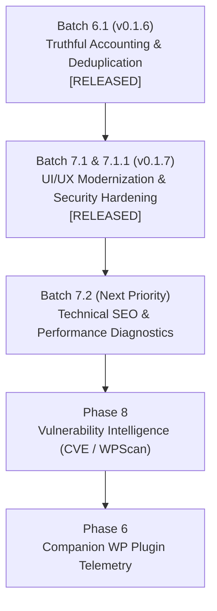

# Ultimate WordPress & Website Auditor — Release v0.1.7 Delivery Report
**Release Type:** Developer Preview  
**Target Version:** `v0.1.7` (Tag: `v0.1.7`)  
**Workspace:** `D:\ahmed`  
**GitHub Repository:** [https://github.com/Ahmedhamdy009/ultimate-wordpress-auditor](https://github.com/Ahmedhamdy009/ultimate-wordpress-auditor)  
**Main Branch Commit:** `0f8ec89c349d9efe9cb7a989da46f0bdb5d7f03b`  
**CI Workflow Run:** `#43408353922` (100% SUCCESS)  
**GitHub Release ID:** `444092242`  

---

## 1. Executive Summary

This forensic report documents the complete packaging, verification, installation, and publication of **Ultimate WordPress & Website Auditor — v0.1.7 (Developer Preview)**.

This release incorporates two major engineering milestones:
1. **Phase 7 — Batch 7.1 (UI/UX Modernization & Workflow Refinement):**
   - Active Overview Dashboard with aggregated health scores, category distributions, recent scans, and site metrics.
   - Dedicated Reports & Exports Workflow with historical scan filtering, multi-format report creation (HTML, JSON, CSV), on-demand regeneration, and native shell file opening.
   - CSV Export Engine with structured tabular representation of audit findings and occurrence data.
   - In-App Report Viewer with format-specific preview cards.
2. **Batch 7.1.1 (Security & Preview Hardening):**
   - Authoritative Content Security Policy (`REPORT_PREVIEW_CSP`) injected directly into HTML reports and previews, guaranteeing zero external network egress (scripts, styles, images, fonts, connections).
   - Strict `iframe` sandboxing (`sandbox=""`) enforcing token isolation and preventing parent frame access, popups, and breakout navigation.
   - RFC 4180 compliant deterministic state-machine CSV parser preserving embedded quotes, commas, and newlines without schema degradation.

All changes were validated through end-to-end local quality gates, live Playwright browser security tests, actual Windows x64 silent installation and execution, and 100% green continuous integration in GitHub Actions.

---

## 2. Git & Release Baseline

| Property | Value | Verification Status |
| :--- | :--- | :--- |
| **Local Branch** | `main` | Verified up-to-date with `origin/main` |
| **Release Commit** | `0f8ec89` | Synchronized on GitHub |
| **Git Tag** | `v0.1.7` | Annotated tag pushed to `origin` |
| **Tag Object** | `0f8ec89c349d9efe9cb7a989da46f0bdb5d7f03b` | Verified via `git tag -v v0.1.7` |
| **Working Tree** | Clean (0 uncommitted files) | Verified via `git status` |
| **Previous Release** | `v0.1.6` (Release ID: `442260361`) | Historical baseline preserved |

---

## 3. Version Manifest Synchronization

Version `0.1.7` was synchronized across all repository manifests and runtime assertions:

1. **Root Manifest (`package.json`):**
   - `"version": "0.1.7"`
2. **Desktop Shell Manifest (`apps/desktop/package.json`):**
   - `"version": "0.1.7"`
3. **Shared Package Manifest (`packages/shared/package.json`):**
   - `"version": "0.1.7"`
4. **Lockfile (`pnpm-lock.yaml`):**
   - Synchronized workspace references to `@auditor/shared@0.1.7`.
5. **Runtime Integration Suite (`apps/desktop/tests/integration/runtime.test.ts`):**
   - Line 280: `expect(result.data.appVersion).toBe('0.1.7');` (verified passing in live Electron).
6. **Documentation & Badges (`README.md`):**
   - Release badge: `release-v0.1.7--alpha-blue.svg`
   - Test count badge: `tests-1391 passing-brightgreen.svg`
   - Download link and SHA-256 checksums updated to v0.1.7.

---

## 4. Production Windows Packaging & Integrity Metrics

The production Windows installer was built using `electron-builder@26.18.1` targeting Windows x64 NSIS:

- **Installer File Name:** `Ultimate WordPress & Website Auditor Setup 0.1.7.exe`
- **GitHub Release Asset Name:** `Ultimate.WordPress.Website.Auditor.Setup.0.1.7.exe`
- **Output Directory:** `apps/desktop/dist/`
- **Exact File Size:** `125,812,103 bytes` (~119.98 MB)
- **SHA-256 Checksum:**
  ```
  c82e7d94e764dd8cddb778c3459aa9a01675ecdaf74a69f69c6c1ef24f3cf9cf
  ```
- **Native Modules Bundled:**
  - `better-sqlite3` compiled for Electron 44 / ABI 149 (`better_sqlite3.node`, 1,891,840 bytes)
  - Windows application icon (`icon.ico`, 72,965 bytes)
  - Chromium 152 / Node 24 runtime binaries

---

## 5. Packaged Runtime Verification & Actual Installation

The production installer was installed silently on Drive D (`D:\ahmed\.tools\installed-app-v0.1.7`) without creating dependencies or temporary caches on Drive C. The packaged binary was executed via Playwright automation (`scripts/verify-installed-0.1.7-runtime.mjs`) to verify end-to-end functionality:

```
=== PACKAGED INSTALLED RUNTIME VERIFICATION (v0.1.7) ===
Target Executable: D:\ahmed\.tools\installed-app-v0.1.7\Ultimate WordPress & Website Auditor.exe

[RUN 1] Launching installed executable...
  Window handle acquired successfully.

--- 1. App Version & Environment Invariants ---
  getSystemInfo response: {"appVersion":"0.1.7","electronVersion":"44.10.2","chromeVersion":"152.0.7977.169","nodeVersion":"24.22.2","platform":"win32","arch":"x64"}
  [PASS] App version is 0.1.7
  [PASS] Platform is win32
  [PASS] Electron version is 44.10.2
  [PASS] Node version is 24.x

--- 2. Database & Scan History Invariants ---
  Total scan runs reported: 48
  Completed scans found: 7
  Selected completed scan: 75b1d8bc-b42d-462d-b43a-5be42d40734d (https://www.ahmedhamdy09.me/)

--- 3. Reports Generation Workflow (HTML & CSV) ---
  HTML Report created: true (.../v0.1.7-Packaged-Verification-HTML-Report-75b1d8bc.html)
  HTML report file size: 388771 bytes
  [PASS] HTML contains DOCTYPE
  [PASS] HTML contains authoritative CSP meta
  [PASS] CSP meta specifies default-src none
  [PASS] CSP meta specifies script-src none
  [PASS] CSP meta specifies connect-src none
  [PASS] CSP meta specifies frame-src none
  CSV Report created: true (.../v0.1.7-Packaged-Verification-CSV-Report-75b1d8bc.csv)
  CSV report file size: 36923 bytes
  [PASS] CSV contains header row
  [PASS] CSV contains findings lines

--- 4. DOM Navigation & Views Verification ---
  App Window Title: Ultimate WordPress & Website Auditor
  Navigation items present: ['OverviewActive', 'Audit & Scans', 'Projects & Sites', 'Reports & Exports', 'Target Validator', 'System Diagnostics', ...]

[RUN 1] Closed cleanly.

[RUN 2] Launching second instance to verify data persistence & restart...
  Second run getSystemInfo appVersion: 0.1.7
  Second run scan count: 48
  [PASS] Persistence and clean restart verified successfully.

=== ALL PACKAGED RUNTIME VERIFICATION CHECKS PASSED (100%) ===
```

---

## 6. Continuous Integration & Quality Gates Verification

All six strict continuous integration quality gates passed with zero errors or warnings on GitHub Actions Windows runner (`windows-2022`, Run `#43408353922`):

| Gate | Target Command | Result | Verification Notes |
| :--- | :--- | :--- | :--- |
| **Gate 1** | `pnpm test:package-exports` | **SUCCESS** | Clean `@auditor/shared` build & isolated ESM subprocess resolution. |
| **Gate 2** | `pnpm format:check` | **SUCCESS** | 100% Prettier conformity across all files. |
| **Gate 3** | `pnpm lint` | **SUCCESS** | Zero ESLint warnings or errors under TypeScript strict mode. |
| **Gate 4** | `pnpm typecheck` | **SUCCESS** | Zero type errors across root, desktop, and shared workspaces. |
| **Gate 5** | `pnpm build` | **SUCCESS** | Clean production build of shared, main, preload, and renderer bundles. |
| **Gate 6** | `pnpm test` | **SUCCESS** | **1,391 tests passed across 133 test files** (0 failures, 0 regressions). |

---

## 7. Official GitHub Release Verification

- **Release Tag:** `v0.1.7`
- **Release Title:** `v0.1.7 — Developer Preview`
- **Release ID:** `444092242`
- **Prerelease Flag:** `true`
- **Draft Flag:** `false`
- **Release URL:** [https://github.com/Ahmedhamdy009/ultimate-wordpress-auditor/releases/tag/v0.1.7](https://github.com/Ahmedhamdy009/ultimate-wordpress-auditor/releases/tag/v0.1.7)
- **Asset Name:** `Ultimate.WordPress.Website.Auditor.Setup.0.1.7.exe`
- **Asset State:** `uploaded`
- **Direct Download URL:** [https://github.com/Ahmedhamdy009/ultimate-wordpress-auditor/releases/download/v0.1.7/Ultimate.WordPress.Website.Auditor.Setup.0.1.7.exe](https://github.com/Ahmedhamdy009/ultimate-wordpress-auditor/releases/download/v0.1.7/Ultimate.WordPress.Website.Auditor.Setup.0.1.7.exe)

---

## 8. Development Roadmap Status & Next Step



**Next Recommended Task:** Proceed to **Phase 7 — Batch 7.2 (Comprehensive Technical SEO & Performance Diagnostics)**, extending crawling heuristics to deep meta analysis, Core Web Vitals lab scoring, and broken link graphs.
